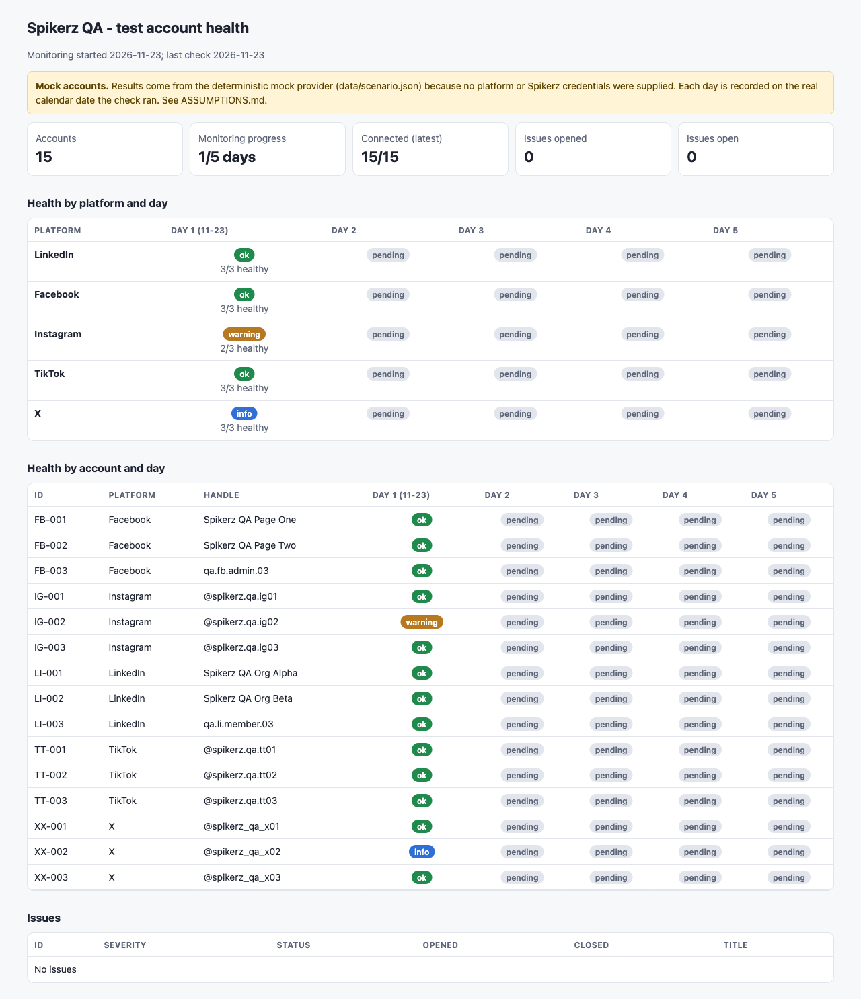

# Spikerz QA: test-account management and monitoring

A Python command-line tool (brief **Option A**) that manages, connects, health-checks and reports on a controlled set of **15 social-media test accounts**: 3 each on LinkedIn, Facebook, Instagram, TikTok and X. Standard library only, SQLite storage, 44 automated tests.



## Highlights

- **Evidence you can trust.** Monitoring is forward-only. Day 1 ran on 2026-11-23, and each daily run appends a new day without touching earlier ones. The tool has no way to backdate a check, and a test enforces that. The scheduled job commits each day, so git history proves when it ran.
- **Detection beyond "is the token valid?".** Eleven failure classes, including the ones that matter for a protection product: an account that looks connected while its token record has lapsed, Spikerz onboarding never completed, a Page deactivated on the platform, a lock whose unlock silently revokes tokens, and a check that can't conclude (which never overwrites the inventory with a guess).
- **Closed-loop issue handling.** Issues open automatically with repro steps, evidence, likely root cause and next action. They are deduplicated, and they close themselves when the condition stops reproducing. Every change is in an audit trail and a day-by-day maintenance log.
- **Policy-safe by design.** Mock accounts instead of throwaway profiles, read-only platform calls, no login automation, and secrets held only as references (`env:NAME`). A pasted raw token is rejected on import.
- **Clean, extensible architecture.** Providers report state, a pure evaluator judges it, a runner orchestrates and a store persists. Adding a platform or a data source means adding data or one class, not editing the core.

> All accounts are **mock accounts**: the brief supplies no Spikerz environment or platform credentials, and creating 15 real throwaway accounts would break platform policy. [ASSUMPTIONS.md](ASSUMPTIONS.md) records this and every other judgement call, including how the 72-hour deadline relates to five calendar days of monitoring.

## Requirements coverage

| Brief requirement | Where it's met |
|---|---|
| 15 accounts, at least 3 per platform | `data/accounts.json`. The minimum is validated on import and on retire (`check_distribution`) |
| Inventory fields (ID, platform, type, environment, owner, status, connection, assets, permissions, last check, notes, credential ref) | `models.Account`, `db.accounts`; see [Data model](#data-model) |
| Real or mock accounts, with the approach stated | Mock, with reasons in ASSUMPTIONS M-02 and A-01. Per-account `provider` field (`mock` or `live`) allows mixing |
| Onboarding and connection workflow, with steps and evidence | [`docs/connection-workflow.md`](docs/connection-workflow.md): pre-requisites, steps, evidence checklist, reconnection and lock runbooks |
| Daily check: status, connection, token validity, assets, permissions, anomalies, timestamp | `healthcheck/` (`spikerz-qa check`), one row per account per day |
| Daily report (CSV/JSON/HTML/dashboard) | `reports/daily/<date>.{json,csv,html}` and `reports/dashboard.html` |
| Issue documentation (repro, evidence, root cause, severity, next action) | Automatic: `reports/issues.md` (`spikerz-qa issues`) |
| Five-day maintenance log | `reports/maintenance_log.md`, one section per day |
| Option A: add, update, view and filter | `add`, `update`, `show`, `list --platform/--status/--connection/--team` |
| Option A: import CSV/JSON | `import <file.json or file.csv>` |
| Option A: run, save, report | `check` (saves to SQLite), `report` |
| Option A: secure credential references | `credential_ref` schemes plus validator and redaction; see [Security approach](#security-approach) |
| Option A: unit tests | `tests/`, 44 tests (`python3 -m unittest discover -s tests`) |
| Optional: retry logic | `retry.py`: bounded exponential backoff on 429, 5xx and network errors |
| Optional: alerts | `alerts.py`: `reports/alerts.jsonl`, plus a Slack/Teams webhook via `SPIKERZ_QA_ALERT_WEBHOOK` |
| Optional: dashboard by platform and day | `reports/dashboard.html` |
| Optional: audit trail | `audit_log` table (`spikerz-qa audit`) and `reports/export/audit_log.json` |
| Optional: retirement workflow | `spikerz-qa retire` (soft delete, closes issues, prints a revocation checklist) |
| Optional: CI with tests and report | `.github/workflows/ci.yml`: tests on 3.10 and 3.12, plus the scheduled daily check |
| Reflection | [`REFLECTION.md`](REFLECTION.md) |

## See every failure class now

Days 2 to 5 are recorded only as they actually happen. To see all eleven failure classes being detected, raised and resolved right now, run the five-day scenario tests. They replay it in an in-memory database that is never written to the deliverables:

```bash
python3 -m unittest -v tests.test_spikerz_qa.TestFiveDayScenario tests.test_spikerz_qa.TestRobustnessStates
```

## Deliverables map

| Brief deliverable | Location |
|---|---|
| Account inventory file | [`data/accounts.json`](data/accounts.json) |
| Database export | [`reports/export/`](reports/export/): inventory JSON/CSV and audit log |
| Onboarding and connection workflow | [`docs/connection-workflow.md`](docs/connection-workflow.md) |
| Five-day health-check reports | [`reports/daily/`](reports/daily/): one JSON, CSV and HTML file per day, appended as each day runs (Day 1 = 2026-11-23) |
| Dashboard (health by platform and day) | [`reports/dashboard.html`](reports/dashboard.html) |
| Five-day maintenance log | [`reports/maintenance_log.md`](reports/maintenance_log.md): grows by one section per day |
| Bug reports and issue log | [`reports/issues.md`](reports/issues.md) |
| Alerts | [`reports/alerts.jsonl`](reports/alerts.jsonl) |
| Screenshots | [`evidence/tool/`](evidence/tool/): dashboard and daily report. The Spikerz UI connection steps are a runbook with an evidence checklist (no Spikerz workspace was provided, M-07) |
| Assumptions and limitations | [`ASSUMPTIONS.md`](ASSUMPTIONS.md) |
| Reflection | [`REFLECTION.md`](REFLECTION.md) |
| CI | [`.github/workflows/ci.yml`](.github/workflows/ci.yml) |

## Setup

Requires Python 3.10 or later. There are **no third-party dependencies**.

```bash
git clone <repo> && cd SpikerzAssessment
cp .env.example .env            # optional; only needed for live mode / webhook alerts
pip install -e .                # optional; gives you the `spikerz-qa` command
```

Every command below also works as `python3 -m spikerz_qa ...` without installing.

## How to run

```bash
# 1. Load the 15-account inventory (validated; rejects raw secrets; logs onboarding for today)
python3 -m spikerz_qa import data/accounts.json

# 2. The daily job: check every account for TODAY, then rebuild all reports.
#    First run = Day 1. Run it again tomorrow = Day 2 (Day 1 is kept untouched), and so on.
python3 -m spikerz_qa check                 # each account uses its own provider (mock/live)
python3 -m spikerz_qa report                # rebuild reports without checking

# Inventory management
python3 -m spikerz_qa list --platform instagram --connection connected
python3 -m spikerz_qa show IG-003                   # record, recent checks, audit trail
python3 -m spikerz_qa add TT-004 --platform tiktok --account-type business --team qa-core \
        --credential-ref env:SPIKERZ_QA_TT_004_TOKEN
python3 -m spikerz_qa update LI-002 --set owner_team=qa-integrations --reason "team move"
python3 -m spikerz_qa retire XX-003 --reason "unrecoverable lock"

# Operations
python3 -m spikerz_qa issues --status open
python3 -m spikerz_qa audit LI-002
python3 -m spikerz_qa log "Reconnected via Spikerz UI" --account XX-003

# Tests
python3 -m unittest discover -s tests -v            # or: pytest
```

**Scheduling (Days 2 to 5).** The `daily-health-check` job in `.github/workflows/ci.yml` runs at 09:00 UTC. It checks against the committed `data/spikerz_qa.db` and commits the new day back, so git history shows when each day ran. (The job needs *Settings → Actions → General → Workflow permissions → Read and write* enabled.) `scripts/daily_check.sh` from cron is the local alternative. Use **one** of the two, so there is a single monitoring database.

## Architecture

```
spikerz_qa/
├── cli.py                 thin handlers: parse args -> call domain -> print (no business logic)
├── config.py              every path / env var in one place
├── clock.py               all time handling (now/today/day numbers): forward-only by construction
├── models.py              Account, Finding, enums, severity helpers, platform scope policy
├── credentials.py         credential_ref resolution + secret redaction
├── http.py                the single HTTP client (stdlib, injectable; 429/5xx -> transient)
├── db.py                  Store: generic _insert/_select + JSON/bool column codecs, per-table methods
├── retry.py               bounded exponential backoff for transient failures
├── alerts.py              alerts.jsonl + optional webhook
├── providers/             Strategy pattern: Provider ABC -> MockProvider | LiveProvider
│   ├── __init__.py        AccountRouter: dispatches each account to the provider named on its record
│   ├── mock.py            deterministic scenario keyed by monitoring day (Day 1 = first real run)
│   └── live.py            table-driven Endpoint specs for official read-only APIs
├── healthcheck/
│   ├── evaluator.py       PURE: platform state + previous check -> severity-ranked findings
│   ├── issues.py          issue templates (repro, evidence, root cause, next action)
│   └── runner.py          run_daily: check_account -> sync_inventory -> log_changes -> track_issues
└── reporting.py           rebuilds every output from the DB (daily JSON/CSV/HTML, dashboard, logs, export)
```

Design principles applied:
- **Single responsibility and separation of concerns.** Providers report raw platform state, the evaluator judges it, the runner orchestrates, and the store persists. Each can be tested on its own.
- **DRY.** Time handling lives in `clock`, configuration in `config`, and SQL and JSON encoding in `db` helpers. Severity ranking is in `models.worst/at_least`. Live endpoints are data (`ENDPOINTS`), not four copies of the same method. HTML tables and cards come from shared helpers.
- **Open/closed.** Adding a platform means one `REQUIRED_PERMISSIONS` entry and one `Endpoint`. Adding a data source (for example a Spikerz internal API) means a new `Provider` subclass registered in the router. Nothing else changes.
- **Table-driven behaviour.** Severity per restriction state, finding-to-log-event mapping, inventory-diff events, issue categories and root causes are dictionaries, not `if/elif` chains.
- **Dependency injection.** The HTTP client, clock (`now=`), retry `sleep` and scenario file are all injectable, so the tests need no network and no real waiting.
- **Idempotent, forward-only jobs.** There is one row per account per day, re-running today only replaces today, and reports are always rebuilt from the database.
- **Fail safe.** If a check can't finish, the inventory is **not** overwritten, and alerting failures never break the check.

**Providers** (chosen per account through `Account.provider`; mock and live accounts can share one run)
- **mock**: `data/scenario.json` holds a baseline plus events keyed by *monitoring day*. Day N's state is produced only when Day N's check runs.
- **live**: calls each platform's official, read-only API. Status codes are mapped as follows: 401 means expired, 403 means restricted, 429 or 5xx is retried, any other 4xx fails. *These adapters are unit-tested against stubbed responses only (A-02).*

## Data model

**accounts** (the inventory)

| Field | Notes |
|---|---|
| `account_id` | `LI-001`, `FB-001`, `IG-001`, `TT-001`, `XX-001` (regex-validated) |
| `platform` | linkedin, facebook, instagram, tiktok, x |
| `account_type` | personal_profile, page, business, creator, organization |
| `environment` | mock, sandbox, staging, production_test |
| `provider` | mock, live: where this account's health is read from |
| `owner_team`, `handle`, `notes` | operator metadata |
| `status` | active, restricted, suspended, locked, deactivated, retired |
| `connection_status` | pending, connected, disconnected, expired, error |
| `connected_assets` | list, e.g. `page:123`, `org:456`, `ig_account:789` |
| `permissions` | granted scopes (list) |
| `last_health_check` | ISO-8601 UTC |
| `credential_ref` | **reference only**: `env:NAME`, `vault:path`, `aws-sm:name`, `mock:...` |
| `created_at`, `updated_at` | ISO-8601 UTC |

**health_checks**: one row per account per day (`UNIQUE(run_date, account_id)`, so re-running a day is safe). Each row records account status, connection status, `token_valid`, `token_expires_at`, assets, permissions, `missing_permissions`, `severity`, `findings[]`, `attempts` and `source`.

**issues**: `QA-xxx` records with severity, category, repro steps, evidence (JSON), likely root cause, next action, and open/resolved dates. At most one open issue exists per account and category, and it closes automatically when the condition clears.

**audit_log**: who changed which field, when, and the before and after values.

**maintenance_log**: daily events: onboarding, connection, status, permission and asset changes, token refreshes, expiry warnings, transient failures, corrective actions and resolutions.

**Severity model:** `critical` means the account is locked or suspended. `error` means Spikerz can't operate on the account (expired, disconnected, missing scope, restricted, deactivated). `warning` means degraded or unknown (token expires within 7 days, connection flag and token record disagree, Spikerz onboarding incomplete, lost asset, check couldn't finish). `info` means healthy but worth noting. `ok` means healthy.

## Security approach

- **No secrets at rest in the repo or the database.** The inventory stores only a `credential_ref`. The validator rejects anything that isn't `scheme:reference`, so a pasted token fails import. A test dumps the whole database and checks that no secret appears.
- Secrets are resolved at runtime from environment variables, or from GitHub encrypted secrets in CI. `vault:` and `aws-sm:` schemes are reserved for a secrets manager. The resolvers are stubbed and fail closed.
- **Redaction**: error text is passed through `credentials.redact()` before it reaches the database, logs, alerts or reports.
- **Least privilege**: the live checks only call read-only and introspection endpoints. They never post, scrape, or automate a platform login. Requesting only the minimum scopes is listed in `REQUIRED_PERMISSIONS`.
- **Policy-safe operations**: account locks are escalated to a human, never automatically retried with a login (see the XX-003 runbook). Accounts are never bulk-created (M-02).
- **Traceability**: every change is written to the audit log. Retirement is a soft delete that prints a revocation checklist.
- `.env`, throwaway `*.db` files and `evidence/**/raw/` (unredacted screenshots) are git-ignored. The monitoring database `data/spikerz_qa.db` is committed on purpose (it holds no secrets) so each day builds on the last.

## Assumptions and limitations (summary)

The full list is in [ASSUMPTIONS.md](ASSUMPTIONS.md).

- All 15 accounts are mock accounts. Each day's events come from a deterministic scenario, but each day is recorded on the real date it ran (Day 1 = 2026-11-23). Days 2 to 5 appear only as they actually run.
- No Spikerz workspace was provided, so the connection workflow is a runbook and there are no fabricated UI screenshots.
- The tool checks **platform-side** health. Spikerz's own connection state needs an internal API or UI automation (M-05).
- The live adapters are untested against real accounts.
- This is a single-operator CLI: the audit actor comes from `--actor` or `SPIKERZ_QA_ACTOR`, not from SSO.
